# Uber Real-Time Azure Data Engineering Project


An end-to-end, real-time Azure data platform built around a simulated Uber-style ride-booking data stream. A Python producer pushes live ride events into Azure Event Hub, Azure Data Factory handles metadata-driven ingestion of reference and bulk historical data, and Databricks Spark Declarative Pipelines consume the stream through Bronze/Silver/Gold into a governed Unity Catalog star schema — including a Slowly Changing Dimension (SCD Type 2) and a bulk historical load path running alongside the live stream.

## Project Overview

### The Problem

Ride-booking data isn't a batch file that lands once a day — it's events arriving continuously, from a live app, that need to be captured, joined against reference data, and turned into queryable history without losing a single ride or duplicating one.

### The Solution

Treat the stream as the source of truth. Land it raw, clean it once, and build a governed star schema on top that keeps history where history matters (location) and reflects the latest state everywhere else.

| Technique | First principle |
|---|---|
| **Event Hub (Kafka-compatible) ingestion** | Capture events as they happen — no polling, no batch windows |
| **Metadata-driven ADF ingestion** | Reference/mapping data and bulk historical files are config-driven, not pipeline-per-file |
| **Bronze landing (raw JSON, array + JSON-Lines aware)** | Land exactly what arrived; parse formats defensively |
| **Structured Streaming into Silver** | A continuous append flow from Bronze into a staging table, not a scheduled re-read |
| **Streaming Table + watermark** | Tolerate late/out-of-order events without unbounded state |
| **One-Big-Table (OBT) Silver model** | Join every lookup once, so Gold never has to re-join raw mapping tables |
| **`pyspark.pipelines` declarative flows** | Declare *what* each table is, let the pipeline runtime manage execution and state |
| **`create_auto_cdc_flow` + SCD Type 2** | Location history is preserved — every city update keeps its own validity window |
| **Keyless governance** | Identity grants access — no keys to leak |
| **Secret-scanning push protection** | A hardcoded credential never reaches the remote, even by accident |

Same rule everywhere: **the pipeline reacts to how the data changes — not to how often new data shows up.**

### Why This Stands Out

Every technique here earns its place by making the pipeline more real-time, more reliable, or safer to trust — not by checking a box. Event Hub ingestion means a ride is queryable within minutes of being booked, not after the next overnight batch. The watermarked Silver streaming table tolerates events that arrive out of order without holding unbounded state. The One-Big-Table pattern means every Gold dimension and the fact table read from a single pre-joined source instead of each re-deriving the same joins. SCD Type 2 on `dim_location` keeps a genuine audit trail of every city update rather than overwriting it. And Unity Catalog's Access Connector removes storage keys from every notebook and pipeline entirely — reinforced, in practice, by GitHub's push protection catching a hardcoded Event Hub key before it ever reached the remote. Together, these are the choices that keep a streaming pipeline trustworthy under real, continuous load — not just working once, but working well as events keep arriving.

## Architecture Overview

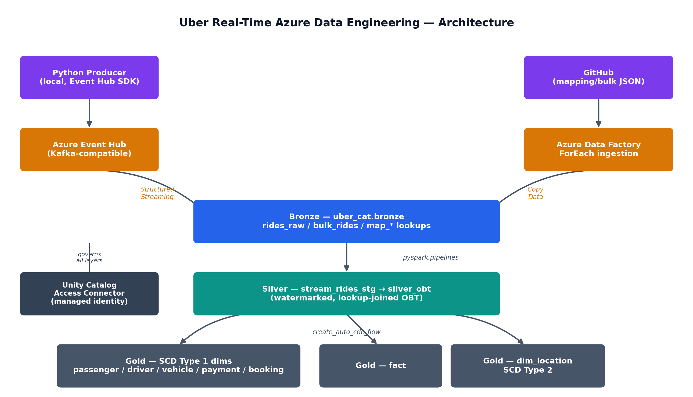

A Python producer streams simulated ride-booking events into Azure Event Hub over its Kafka-compatible endpoint; Databricks Structured Streaming consumes that stream into Bronze alongside reference/bulk data copied in by Azure Data Factory. From Bronze, a Spark Declarative Pipeline builds a watermarked, lookup-joined Silver One-Big-Table, then fans out into seven governed Gold tables — six via `create_auto_cdc_flow` SCD Type 1, and `dim_location` as SCD Type 2 — all under Unity Catalog's Access Connector (managed identity) governance.

---

## Resource Group

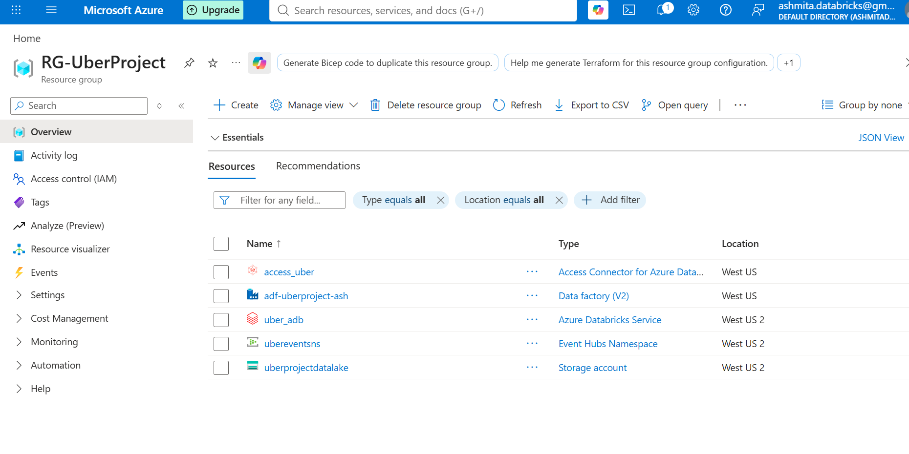

All resources live in a single resource group (`RG-UberProject`):

| Resource | Purpose |
|---|---|
| `adf-uberproject-ash` | Azure Data Factory — metadata-driven ingestion of reference/bulk JSON from GitHub |
| `uber_adb` | Azure Databricks workspace — streaming consumer, Bronze/Silver/Gold SDP pipeline, Unity Catalog |
| `ubereventsns` | Event Hubs Namespace — hosts `ubereventhub`, the Kafka-compatible streaming endpoint |
| `uberprojectdatalake` | ADLS Gen2 storage account — raw landing zone + Unity Catalog managed storage |
| `access_uber` | Access Connector for Azure Databricks — lets Unity Catalog read/write the data lake via managed identity |

---

## 1. Event Streaming — Azure Event Hub

**Namespace:** `ubereventsns` (Standard tier, 1 throughput unit, Kafka surface enabled) · **Event Hub:** `ubereventhub` (1 partition, 168-hour retention)

| Step | Screenshot |
|---|---|
| Namespace overview + metrics |  |
| Event Hub instance overview | 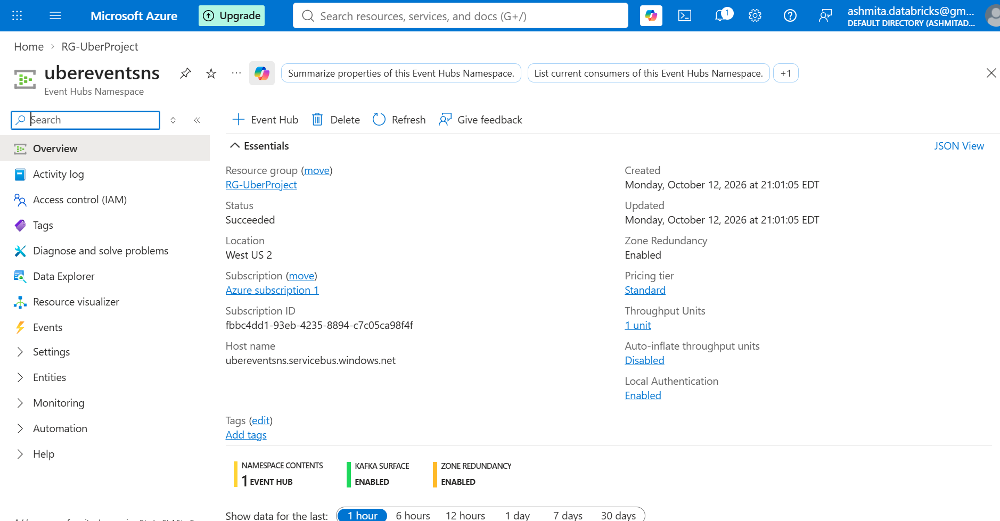 |
| Shared access policies — `SendPolicy` / `ListenPolicy` split |  |
| SAS policy detail (keys masked) | 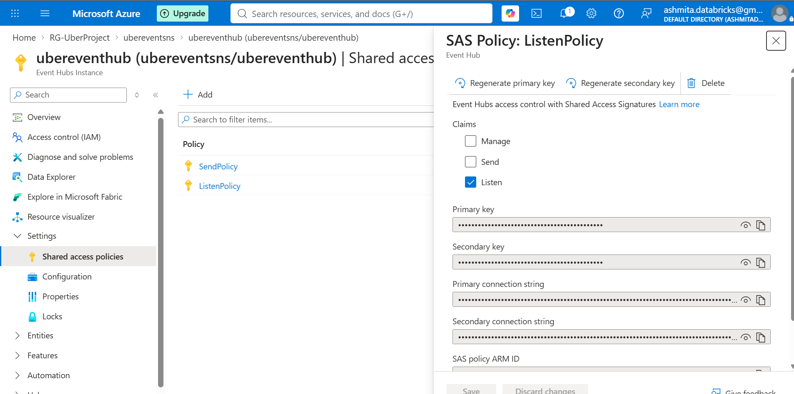 |
| Data Explorer — ride events received in real time | 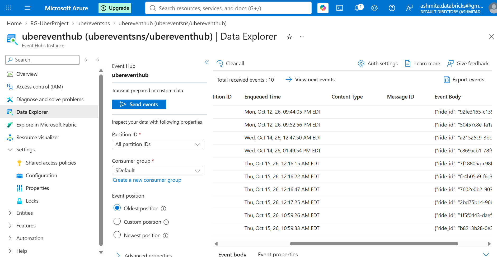 |
| Producer `connection.py` — `EventHubProducerClient` |  |
| `Events_ingest.py` — Kafka consumer config |  |

A local Python producer app (`connection.py`, run from VS Code with a `uv`-managed venv) builds an `EventHubProducerClient` from a connection string and hub name pulled from environment variables (`.env` via `python-dotenv`), generates a ride confirmation record, batches it, and sends it to Event Hub. Access is split by purpose — `SendPolicy` (Send claim only, for the producer) and `ListenPolicy` (Listen claim only, for the Databricks consumer) — least-privilege instead of one all-access key.

```python
# connection.py
CONNECTION_STRING = os.getenv("CONNECTION_STRING")
EVENT_HUBNAME = os.getenv("EVENT_HUBNAME")

def send_to_event_hub(ride_data=None, batch_size=1):
    producer = EventHubProducerClient.from_connection_string(
        CONNECTION_STRING, eventhub_name=EVENT_HUBNAME
    )
    ride_json = json.dumps(ride_data)
    event_batch = producer.create_batch()
```

```python
# Events_ingest.py — Kafka consumer config
EH_NAMESPACE = "ubereventsns"
EH_NAME = "ubereventhub"
EH_CONN_STR = spark.conf.get("connection_string")

KAFKA_OPTIONS = {
    "kafka.bootstrap.servers": f"{EH_NAMESPACE}.servicebus.windows.net:9093",
    "subscribe": EH_NAME,
    "kafka.sasl.mechanism": "PLAIN",
    "kafka.security.protocol": "SASL_SSL",
}
```

Databricks consumes the stream using Spark's Kafka source, reading the connection string securely via `spark.conf.get("connection_string")` rather than hardcoding it. An earlier exploration notebook had the connection string inline — GitHub's secret-scanning push protection caught it and blocked the push until it was replaced with a placeholder, confirming the safeguard works end to end.

---

## 2. Ingestion — Azure Data Factory

**Data Factory:** `adf-uberproject-ash`, Git-integrated against the project's GitHub repo (root folder `adf_pipelines`, collaboration branch `main`, publish branch `adf_publish`) — the same Git-integration structure used on the Spotify and Netflix projects.

| Step | Screenshot |
|---|---|
| Pipeline canvas — `Lookup` → `ForEach`, debug run succeeded |  |
| Pipeline full-screen view with run output |  |
| Pipeline run history — multiple days, mostly succeeded |  |
| `ForEach` settings — items bound to the `Lookup` output |  |
| Copy Data — source dataset `ds_github` |  |
| Linked service — `ls_github` (HTTP, raw.githubusercontent.com) |  |
| Linked service — `ls_datalake` (ADLS Gen2) |  |
| Dataset — `ds_files_array` (Lookup source) | 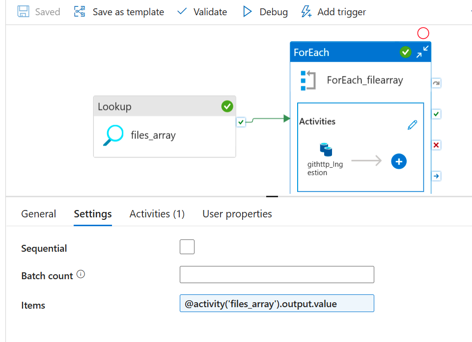 |
| Dataset — `ds_ingestion` (parameterized sink path) |  |
| GitHub PR merged — Uber ingestion pipeline |  |
| GitHub push protection blocking a hardcoded Event Hub key |  |
| Push succeeding after replacing the secret with a placeholder | 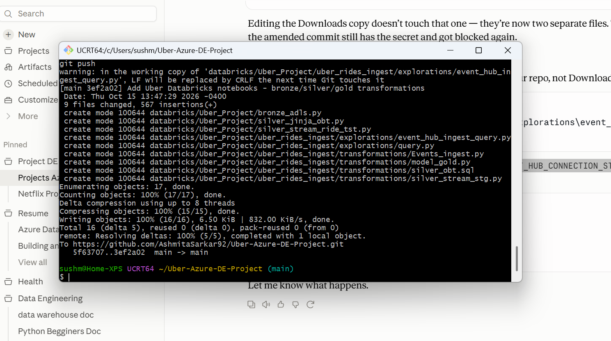 |

**Key pattern:** `githubhttp_adf_adls` is metadata-driven over the repo's raw mapping/bulk JSON files — a `Lookup` (`files_array`) feeds a `ForEach_filearray` (items = `@activity('files_array').output.value`), which runs a `Copy data` activity (`githttp_Ingestion`) per file from `ds_github` (HTTP, `ls_github`) into `ds_ingestion` (ADLS Gen2, `ls_datalake`, parameterized path `@{dataset().p_file}.json`). This is how the project's reference/mapping tables and the one-time historical `bulk_rides` dataset reach the lake — new source files are a config entry in `files_array`, not a new pipeline. The work was developed on an `adf-setup` branch and merged into `main` via pull request before publishing.

---

## 3. Storage — ADLS Gen2 (`uberprojectdatalake`)

| Step | Screenshot |
|---|---|
| Storage account containers — `raw`, `databricksmetastore`, `$logs` | 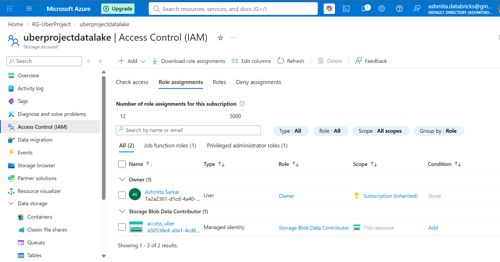 |
| `raw` container root — `ingestion/` + `files_array.json` |  |
| `raw/ingestion` — `bulk_rides.json` and `map_*` reference files | 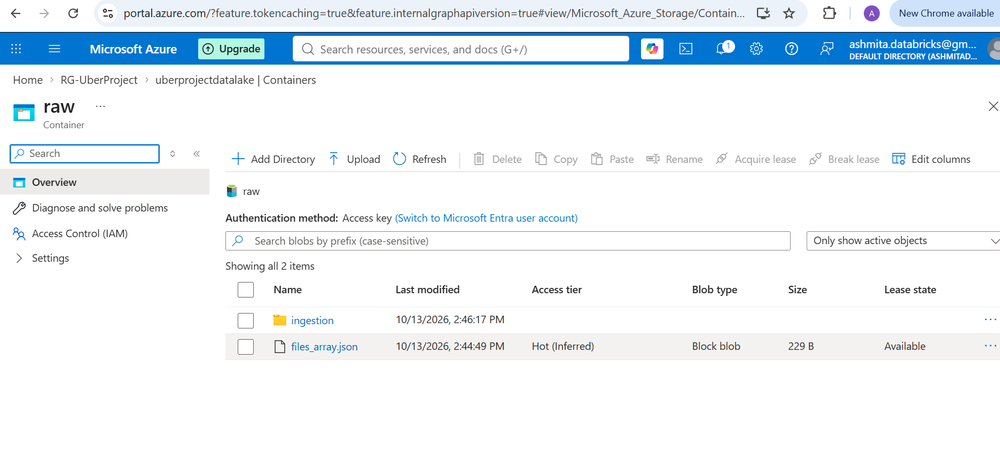 |
| Storage account IAM — Owner + Managed Identity roles | 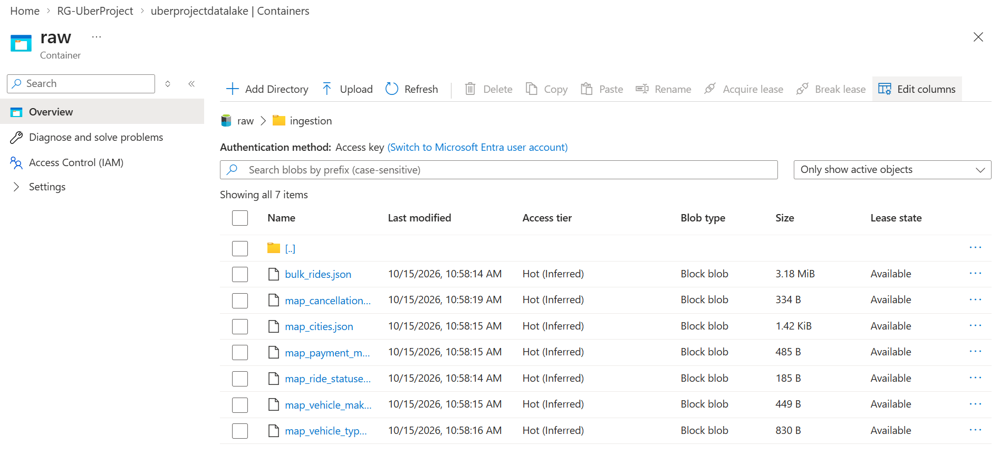 |

`raw/files_array.json` drives the ADF `Lookup`; `raw/ingestion/` holds the files ADF copies in — `bulk_rides.json` (3.18 MiB) plus the six `map_*.json` reference files. The storage account's IAM shows two role assignments — `Ashmita Sarkar` as `Owner` (inherited from the subscription) and the `access_uber` managed identity as `Storage Blob Data Contributor`, scoped to this resource.

---

## 4. Governance — Unity Catalog & Access Connector

| Step | Screenshot |
|---|---|
| Access Connector for Azure Databricks (`access_uber`) |  |
| Unity Catalog credential (`access_cred`) — Managed Identity | 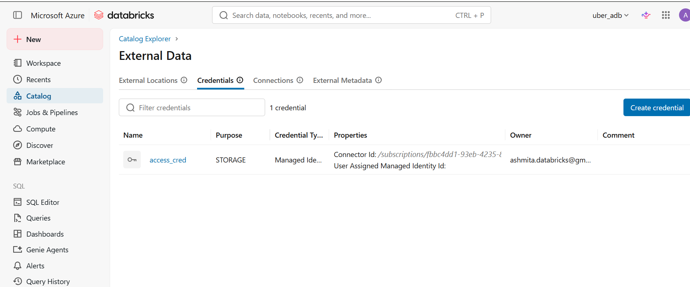 |
| External Location — `raw` |  |

**Metastore:** `uber_unity_metastore` (region `westus2`) — created after deleting an auto-provisioned default metastore that had no free metastore slot in the region; the `uber_adb` workspace is assigned to it.

Unity Catalog reaches the data lake through a dedicated **Access Connector** (`access_uber`, a managed identity), registered as credential `access_cred` (purpose `STORAGE`) and granted `Storage Blob Data Contributor` on the storage account. One **External Location** (`raw`) binds that credential to `abfss://raw@uberprojectdatalake.dfs.core.windows.net/` — no storage keys are embedded in notebooks or pipelines. Tables live in `uber_cat.bronze` / `uber_cat.silver` / `uber_cat.gold`.

---

## 5. Databricks — Bronze Layer

| Step | Screenshot |
|---|---|
| `bronze_adls.py` — `BASE_PATH` + files list driving the raw→bronze load | 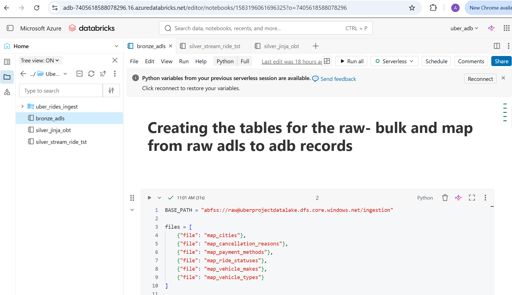 |

```python
BASE_PATH = "abfss://raw@uberprojectdatalake.dfs.core.windows.net/ingestion"

files = [
    {"file": "map_cities"},
    {"file": "map_cancellation_reasons"},
    {"file": "map_payment_methods"},
    {"file": "map_ride_statuses"},
    {"file": "map_vehicle_makes"},
    {"file": "map_vehicle_types"},
]
```

Reads raw JSON from ADLS for every mapping/reference file plus the one-time historical `bulk_rides` load. A shared `read_json` helper handles both JSON array and JSON-Lines formats defensively, so a source file's exact shape doesn't break ingestion. Writes land as overwrite-mode tables in `uber_cat.bronze`.

---

## 6. Databricks — Silver Layer

| Step | Screenshot |
|---|---|
| `silver_stream_ride_tst.py` — `rides_schema` StructType | 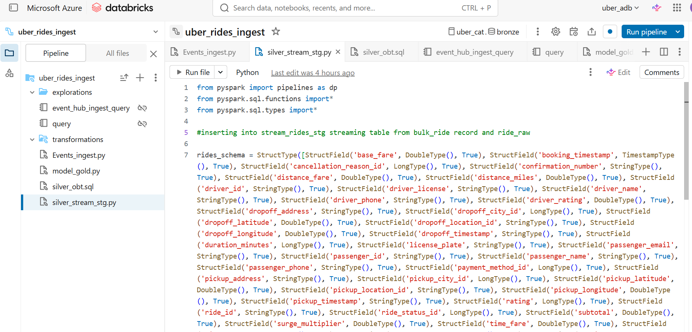 |
| `silver_stream_stg.py` — bulk + live append flows into `stream_rides_stg` | 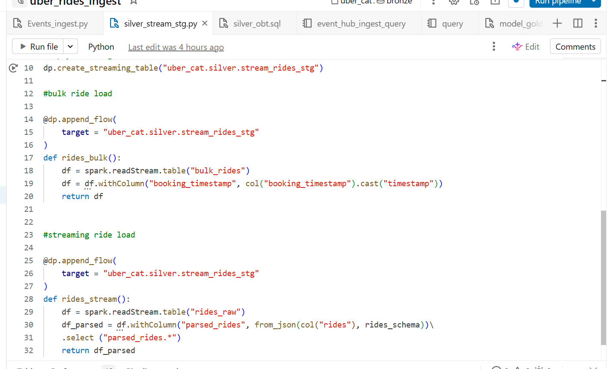 |
| `silver_stream_ride_tst.py` — exploration notebook, testing note | 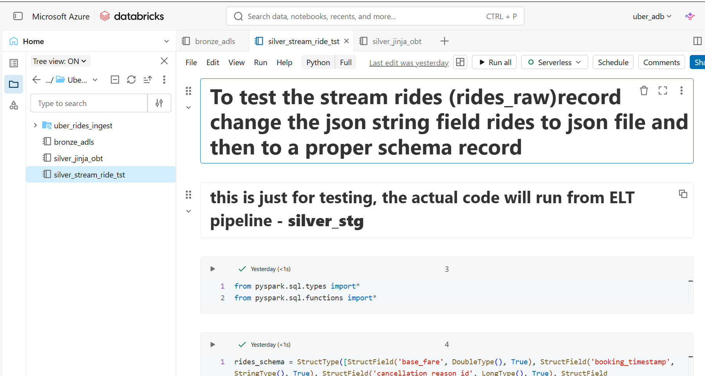 |
| `silver_jinja_obt.py` — Jinja2 template looping over `jinja_config` |  |
| `silver_obt.sql` — streaming table, watermark, chained `LEFT JOIN`s |  |
| `query.py` — sample enriched Silver OBT result |  |

```python
dp.create_streaming_table("uber_cat.silver.stream_rides_stg")

@dp.append_flow(target="uber_cat.silver.stream_rides_stg")
def rides_bulk():
    df = spark.readStream.table("bulk_rides")
    df = df.withColumn("booking_timestamp", col("booking_timestamp").cast("timestamp"))
    return df

@dp.append_flow(target="uber_cat.silver.stream_rides_stg")
def rides_stream():
    df = spark.readStream.table("rides_raw")
    df_parsed = df.withColumn("parsed_rides", from_json(col("rides"), rides_schema))\
                  .select("parsed_rides.*")
    return df_parsed
```

```sql
CREATE OR REFRESH STREAMING TABLE uber_cat.silver.silver_obt
AS
SELECT ...
FROM
    STREAM(uber_cat.silver.stream_rides_stg)
    WATERMARK booking_timestamp DELAY OF INTERVAL 3 MINUTES stream_rides_stg
    LEFT JOIN uber_cat.bronze.map_vehicle_makes ...
    LEFT JOIN uber_cat.bronze.map_vehicle_types ...
    LEFT JOIN uber_cat.bronze.map_ride_statuses ...
    LEFT JOIN uber_cat.bronze.map_payment_methods ...
    LEFT JOIN uber_cat.bronze.map_cities ...
    LEFT JOIN uber_cat.bronze.map_cancellation_reasons ...
```

`silver_jinja_obt.py` generates the Silver One-Big-Table SQL dynamically with Jinja2 — the same metadata-driven templating pattern used on the Spotify project: a template loops over a `jinja_config` list, rendering a `SELECT` column list and a `FROM`/`LEFT JOIN` chain, so a new lookup join is a metadata entry, not new SQL. The resulting `silver_obt` streams from `stream_rides_stg` with a 3-minute watermark and joins every Bronze lookup table, so every downstream Gold table reads from one clean, fully-enriched streaming source.

---

## 7. Databricks — Gold Layer (Spark Declarative Pipelines)

| Step | Screenshot |
|---|---|
| `model_gold.py` — `dim_passenger_view` + `create_auto_cdc_flow`, SCD type 1 | 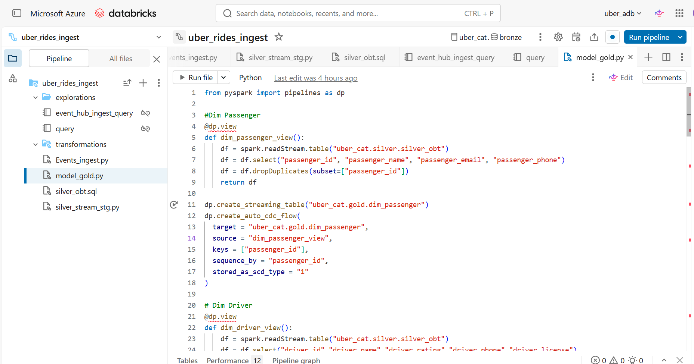 |
| Full pipeline DAG — Bronze through Gold, run completed |  |
| Pipeline tables — all 17 tables, Gold dims + fact + Silver OBT |  |
| Pipeline tables — Gold views layer | 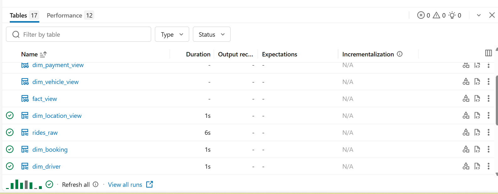 |
| Pipeline run history — `uber_rides_ingest` | 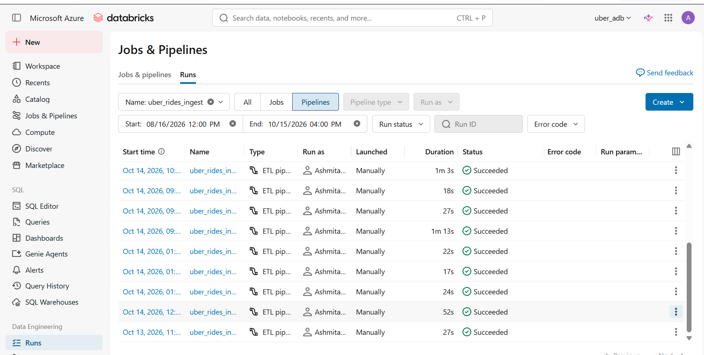 |
| Pipeline run history — continued, including a cancelled test run | 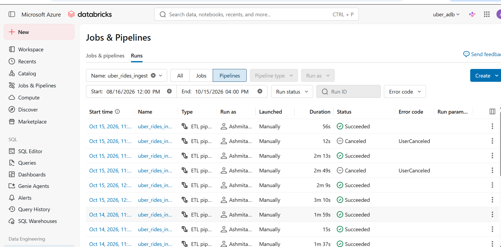 |
| Gold schema — 7 governed tables |  |
| Bronze schema — 9 tables + volume |  |
| Silver schema — `stream_rides_stg`, `silver_obt` | 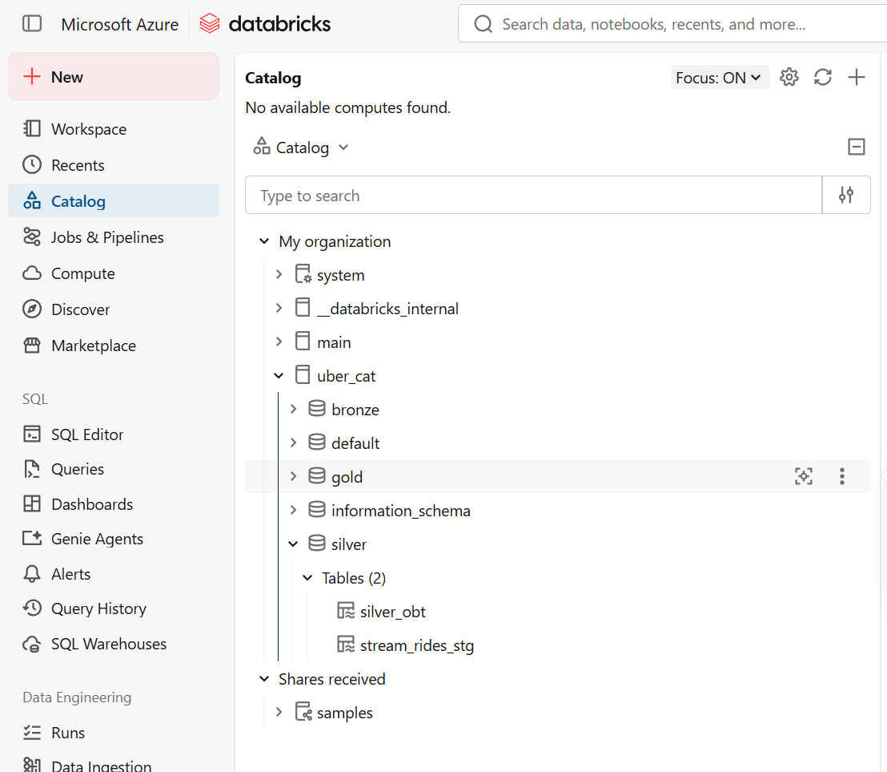 |

Built with the `pyspark.pipelines` (`dp`) API and `dp.create_auto_cdc_flow`, all sourced from streaming views over `silver_obt`:

| Table | Grain / key | SCD type |
|---|---|---|
| `dim_passenger` | `passenger_id` | 1 |
| `dim_driver` | `driver_id` | 1 |
| `dim_vehicle` | `vehicle_id` | 1 |
| `dim_payment` | `payment_method_id` | 1 |
| `dim_booking` | `ride_id` | 1 |
| `dim_location` | `pickup_city_id`, sequenced by `city_updated_at` | **2** |
| `fact` | `ride_id`, `pickup_city_id`, `payment_method_id`, `driver_id`, `passenger_id`, `vehicle_id` | 1 |

```python
@dp.table
def dim_location_view():
    df = spark.readStream.table("uber_cat.silver.silver_obt")
    df = df.select("pickup_city_id", "pickup_city", "city_updated_at", "region", "state")
    return df.dropDuplicates(subset=["pickup_city_id", "city_updated_at"])

dp.create_streaming_table("uber_cat.gold.dim_location")
dp.create_auto_cdc_flow(
  target="uber_cat.gold.dim_location",
  source="dim_location_view",
  keys=["pickup_city_id"],
  sequence_by="city_updated_at",
  stored_as_scd_type=2,
)
```

`dim_location` is the one table that keeps full history: every change to a city's `region`/`state` data inserts a new version with its own `__START_AT`/`__END_AT` validity window, rather than overwriting the row — the same SCD Type 2 pattern proven out on the Spotify project, here implemented with the newer `pyspark.pipelines` API instead of `dlt`. The full pipeline (`uber_rides_ingest`) runs this entire DAG — Event Hub subscription and Bronze landing through Silver OBT and every Gold CDC flow — as one Lakeflow Declarative Pipeline, completing all 17 tables successfully with consistent manual-trigger run history.

---

## Tech Stack

- **Streaming ingestion:** Azure Event Hub (Kafka-compatible protocol, Send/Listen SAS policies), Python producer (local, `uv`-managed venv)
- **Orchestration:** Azure Data Factory (metadata-driven `ForEach` ingestion, Git-integrated, PR-based workflow)
- **Storage:** Azure Data Lake Storage Gen2 (Bronze / Silver / Gold medallion architecture)
- **Compute:** Azure Databricks (Spark Structured Streaming, `pyspark.pipelines` Declarative Pipelines)
- **Governance:** Unity Catalog with an Access Connector managed identity (no embedded storage keys)
- **Templating:** Jinja2 for metadata-driven Silver SQL generation
- **Source control:** GitHub (`AshmitaSarkar92/Uber-Azure-DE-Project`), PR-based merges, secret-scanning-verified pushes

## Repository Structure

```
├── Raw_Data/                 # Raw mapping/bulk JSON source files for ADF HTTP ingestion
├── adf_pipelines/            # Azure Data Factory pipeline, dataset, and linked service JSON
├── src/uber_de_project/      # Python Event Hub producer app (connection.py, data.py, api.py)
└── databricks/
    └── Uber_Project/
        ├── bronze_adls.py            # Bronze landing (raw JSON, array + JSON-Lines aware)
        └── uber_rides_ingest/
            ├── explorations/          # event_hub_ingest_query.py, query.py
            └── transformations/       # Events_ingest.py, silver_stream_stg.py, silver_obt.sql, model_gold.py
└── screenshots/
    ├── uber_setup_ss/             # architecture diagram, resource group
    ├── uber_eventhub_ss/
    ├── uber_adf_ss/
    ├── uber_datalake_ss/
    ├── uber_access_connector_ss/
    ├── uber_unitycatalog_ss/
    └── uber_databricks_ss/
```
