# Uber Real-Time Azure Data Engineering Project

Azure Event Hub (Kafka protocol) · Azure Data Factory · Databricks Spark Declarative Pipelines · Delta Lake · Unity Catalog · Python

An end-to-end, real-time Azure data platform built around a simulated Uber-style ride-booking data stream: a Python producer app pushes live ride events into Azure Event Hub, Azure Data Factory handles metadata-driven historical/reference ingestion, and Databricks Spark Declarative Pipelines (SDP) consume the stream through Bronze → Silver → Gold into a governed Unity Catalog star schema — including an SCD Type 2 dimension and a bulk historical load path alongside the live stream.

## Project Overview

### The Problem

Ride-booking data isn't a batch file that lands once a day — it's events arriving continuously, from a live app, that need to be captured, joined against reference data, and turned into queryable history without losing a single ride or duplicating one.

### The Solution

Treat the stream as the source of truth. Land it raw, clean it once, and build a governed star schema on top that keeps history where history matters (location) and reflects the latest state everywhere else.

| Technique | First principle |
|---|---|
| Event Hub (Kafka-compatible) ingestion | Capture events as they happen — no polling, no batch windows |
| Metadata-driven ADF ingestion | Reference/mapping data and bulk historical files are config-driven, not pipeline-per-file |
| Bronze landing (raw JSON, array + JSON-Lines aware) | Land exactly what arrived; parse formats defensively |
| Structured Streaming into Silver | A continuous append flow from Bronze into a staging table, not a scheduled re-read |
| Streaming Table + watermark | Tolerate late/out-of-order events without unbounded state |
| One-Big-Table (OBT) Silver model | Join every lookup once, so Gold never has to re-join raw mapping tables |
| `pyspark.pipelines` (`dp`) declarative flows | Declare *what* each table is, let the pipeline runtime manage execution and state |
| `create_auto_cdc_flow` + SCD Type 1 | Dimensions reflect current truth, deduplicated on their natural key |
| `create_auto_cdc_flow` + SCD Type 2 | Location history is preserved — every city update keeps its own validity window |
| Unity Catalog + Access Connector (managed identity) | Governance via identity — no storage keys anywhere in code |
| GitHub secret scanning / push protection | A hardcoded credential never reaches the remote, even by accident |

Same rule as the other projects in this series: the pipeline reacts to how the data changes, not to how often new data shows up.

## Architecture Overview

```
Python producer (local, VS Code / uv venv)
      │  sends simulated ride-booking events
      ▼
Azure Event Hub (ubereventsns / ubereventhub) — Kafka-compatible endpoint
      │  Databricks Structured Streaming consumer (Kafka options)
      ▼
Bronze (uber_cat.bronze) — raw JSON landing + bulk historical load
      │  Databricks Spark Declarative Pipelines
      ▼
Silver (uber_cat.silver) — stream_rides_stg (streaming append) → silver_obt (One Big Table, watermarked joins)
      │  pyspark.pipelines create_auto_cdc_flow
      ▼
Gold (uber_cat.gold) — SCD Type 1 dimensions + SCD Type 2 dim_location + fact
```

All Databricks compute and governance live in the `uber_adb` workspace, backed by its own Unity Catalog metastore (`uber_unity_metastore`, region `westus2`). Azure Data Factory (`adf-uberproject-ash`) separately handles metadata-driven ingestion of reference/mapping JSON and a one-time bulk historical ride load from GitHub-hosted source files.

## 1. Resources — `RG-UberProject`

Every Azure resource for this project lives in a single resource group, `RG-UberProject` (West US / West US 2):

| Resource | Purpose |
|---|---|
| `adf-uberproject-ash` | Azure Data Factory — metadata-driven ingestion of reference/bulk JSON from GitHub |
| `uber_adb` | Azure Databricks workspace — streaming consumer, Bronze/Silver/Gold SDP pipeline, Unity Catalog |
| `ubereventsns` | Event Hubs Namespace — hosts `ubereventhub`, the Kafka-compatible streaming endpoint |
| `uberprojectdatalake` | ADLS Gen2 storage account — raw landing zone + Unity Catalog managed storage |
| `access_uber` | Access Connector for Azure Databricks — managed identity for keyless Unity Catalog storage access |


## 2. Event Streaming — Azure Event Hub

**Namespace:** `ubereventsns` (Standard tier, 1 throughput unit, Kafka surface enabled) · **Event Hub:** `ubereventhub` (1 partition, 168-hour retention) · **Resource Group:** `RG-UberProject`

- A local Python producer app (`connection.py`, run from VS Code with a `uv`-managed venv) builds an `EventHubProducerClient` from a connection string and hub name pulled from environment variables (`.env` via `python-dotenv`), generates a ride confirmation record, batches it, and sends it to Event Hub.
- **Shared access policies** are split by purpose: `SendPolicy` (Send claim only, for the producer) and `ListenPolicy` (Listen claim only, for the Databricks consumer) — least-privilege instead of one all-access key.
- The Data Explorer confirms events landing in real time — ride JSON payloads (`ride_id`, etc.) arriving with enqueued timestamps.
- Databricks consumes the stream using Spark's Kafka source (`Events_ingest.py`), configured with Event Hub's Kafka-compatible endpoint. The connection string is read securely via `spark.conf.get("connection_string")` rather than hardcoded. An earlier exploration notebook (`event_hub_ingest_query.py`) had the connection string inline — GitHub's secret-scanning push protection caught it and blocked the push until it was replaced with a placeholder, confirming the safeguard actually works end to end.

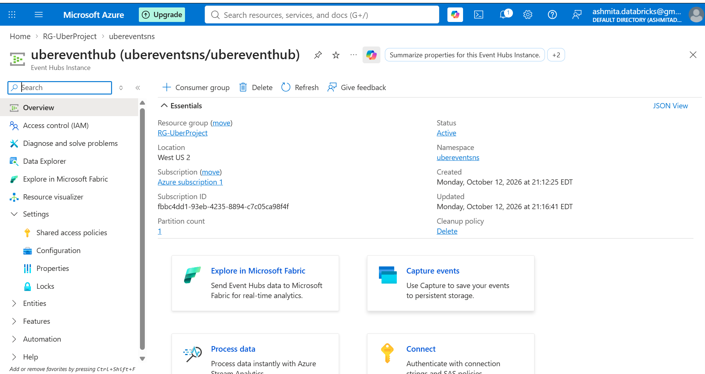

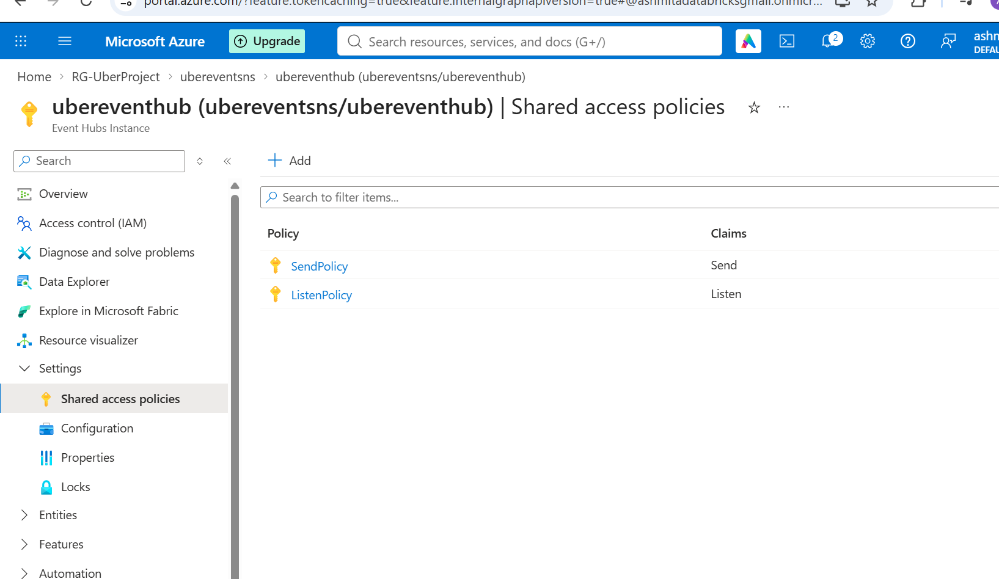


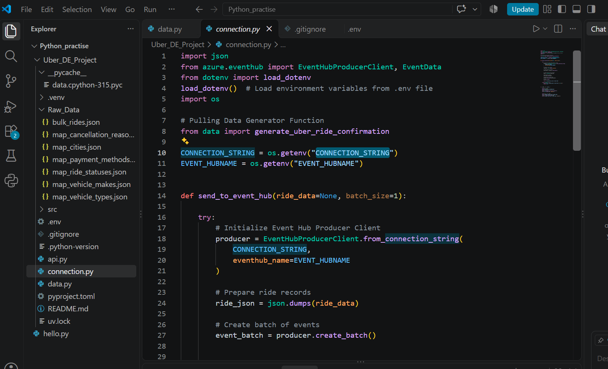
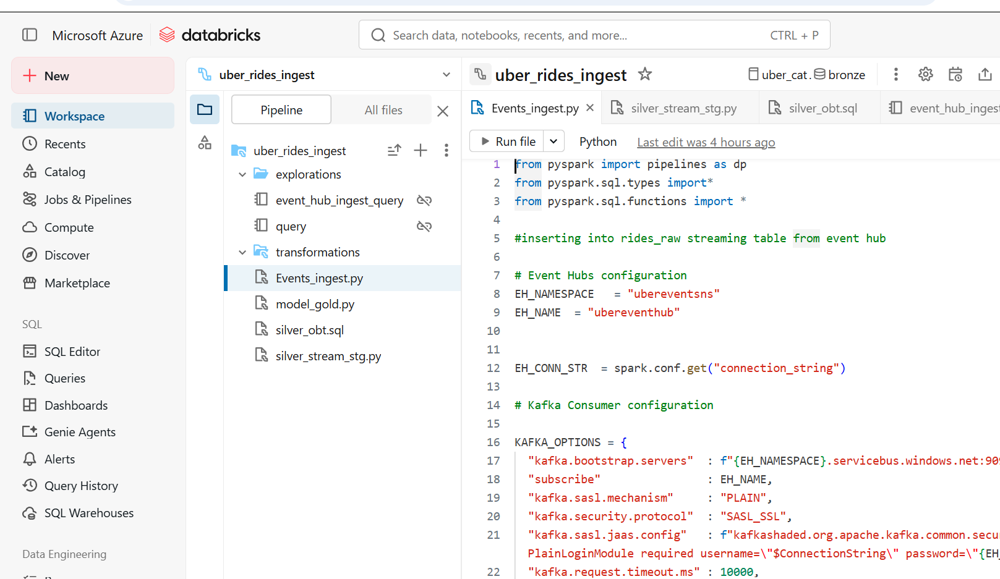

## 3. Ingestion — Azure Data Factory

**Data Factory:** `adf-uberproject-ash`, Git-integrated against the project's GitHub repo (root folder `adf_pipelines`, collaboration branch `main`, publish branch `adf_publish`), mirroring the same Git-integration structure used on the Spotify project.

- **`githubhttp_adf_adls`** — the ingestion pipeline, metadata-driven over the repo's raw mapping/bulk JSON files: a `Lookup` (`files_array`) feeds a `ForEach_filearray` (items = `@activity('files_array').output.value`), which runs a `Copy data` activity (`githttp_Ingestion`) per file — source dataset `ds_github` (linked service `ls_github`, an HTTP connector against `https://raw.githubusercontent.com/`), sink dataset `ds_ingestion` (linked service `ls_datalake`, against `uberprojectdatalake`, parameterized file path `@{dataset().p_file}.json`). All 9 activities succeeded end-to-end (run `873bc1f7-7b32-4911-9a14-43bbf466201f`), and the pipeline has a clean run history over multiple days (8 runs, 7 succeeded, 1 early failure while setting up).
- This pipeline is how the project's reference/mapping tables (vehicle makes/types, ride statuses, payment methods, cities, cancellation reasons) and the one-time historical `bulk_rides` dataset reach the lake — new source files are a config entry in `files_array`, not a new pipeline.
- The ADF work was developed on an `adf-setup` branch and merged into `main` via pull request (10 commits, 6 files changed) before publishing — the same Git-flow used across all three projects in this series.

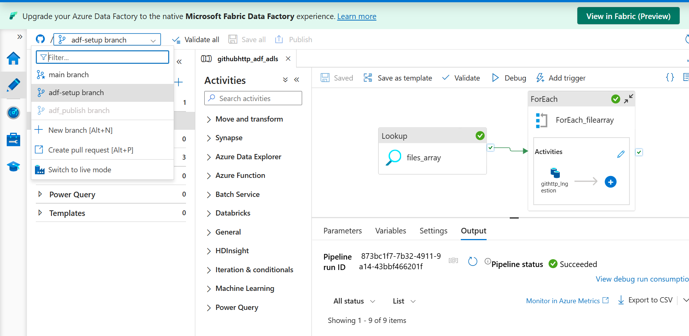
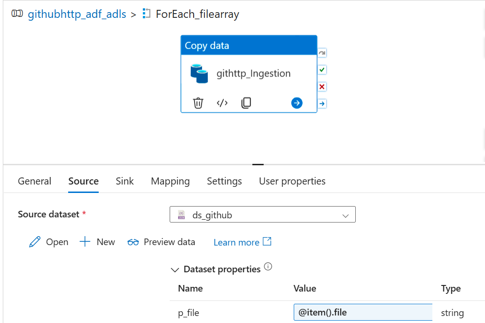
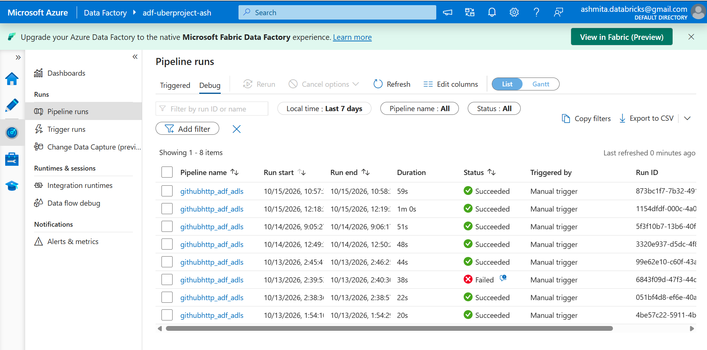
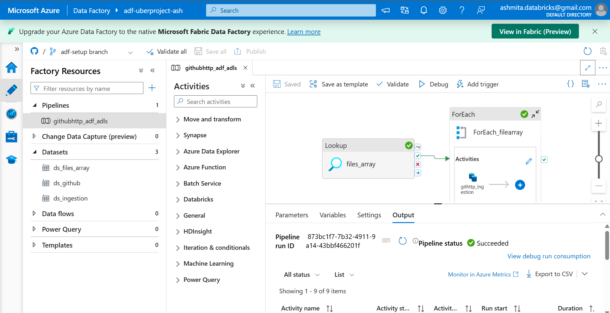
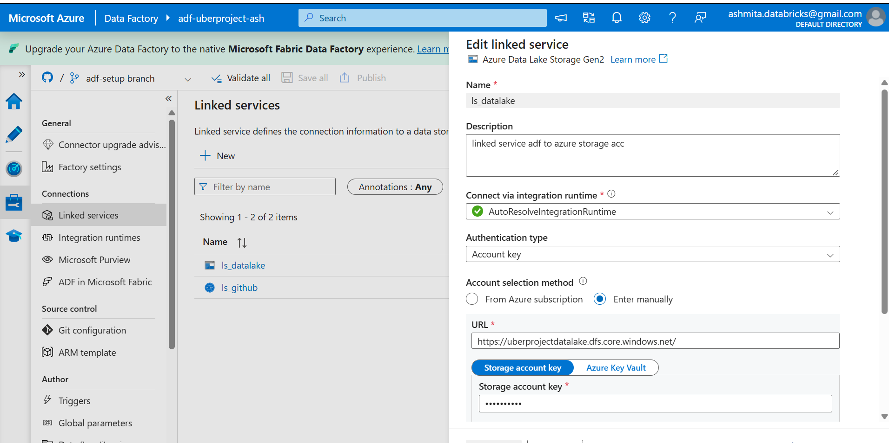
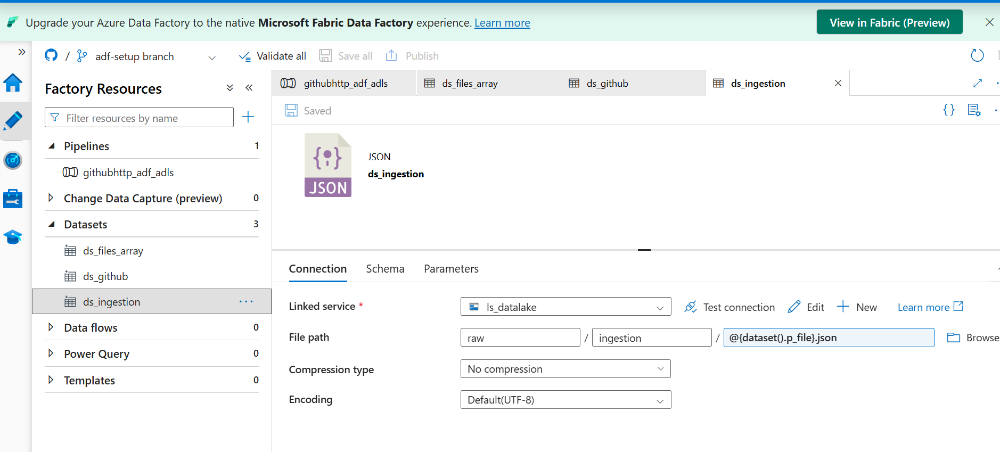
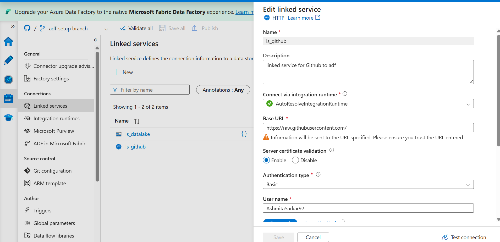

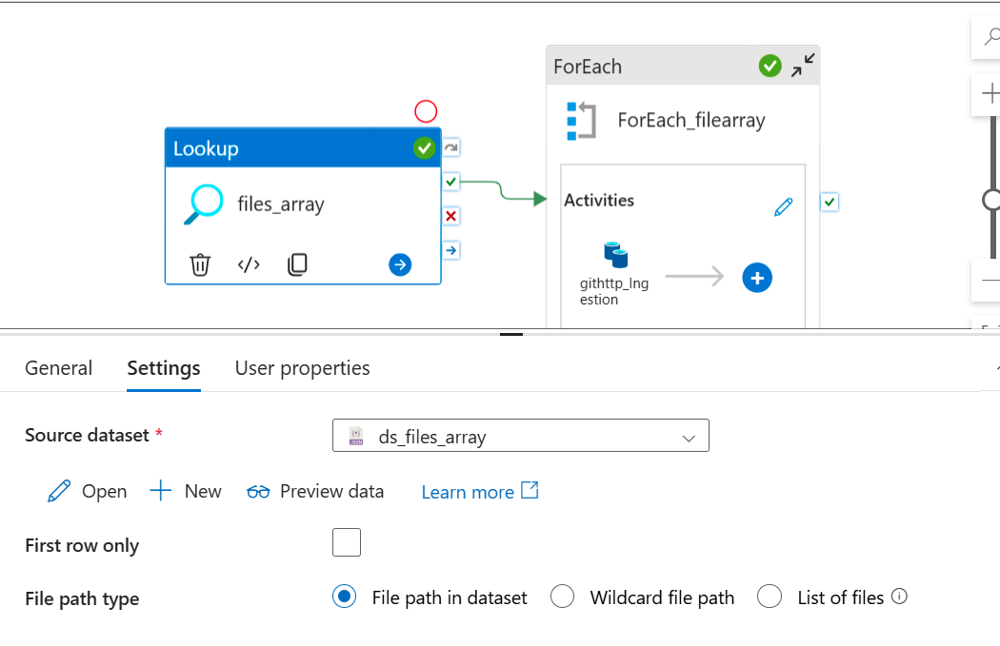
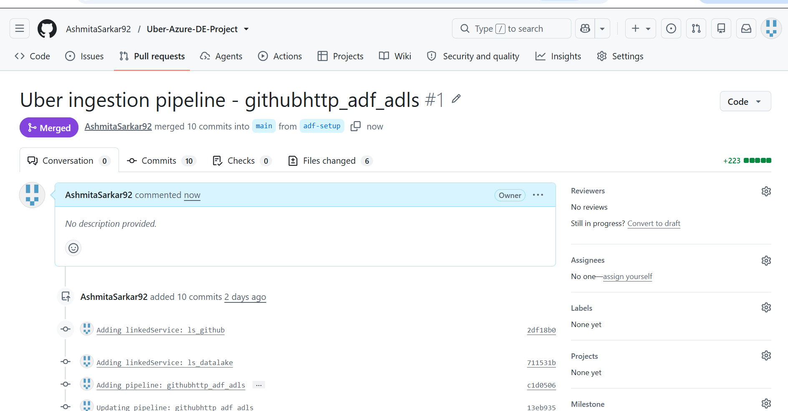
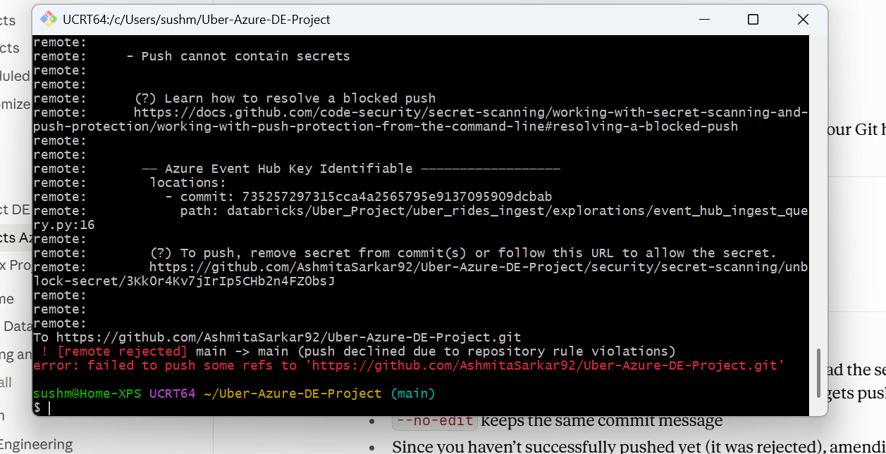


## 4. Storage — ADLS Gen2 (`uberprojectdatalake`)

- **Containers:** `raw` (landing zone), `databricksmetastore` (Unity Catalog managed storage), `$logs`.
- `raw/files_array.json` drives the ADF `Lookup`; `raw/ingestion/` holds the files ADF copies in — `bulk_rides.json` (3.18 MiB) plus the six `map_*.json` reference files.
- **Access control:** the storage account's IAM shows two role assignments — `Ashmita Sarkar` as `Owner` (inherited from the subscription) and the `access_uber` managed identity as `Storage Blob Data Contributor`, scoped to this resource — the same keyless governance pattern used throughout.


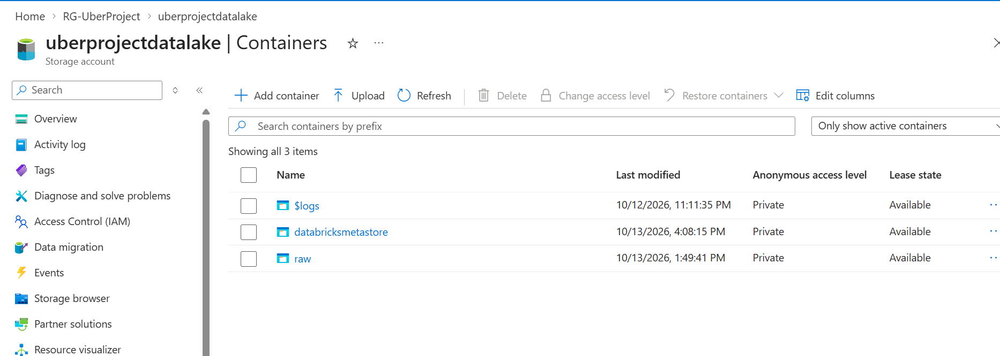


## 5. Unity Catalog & Access Connector

- **Metastore:** `uber_unity_metastore` (region `westus2`) — created after deleting an auto-provisioned default metastore that had no free metastore slot in the region; the `uber_adb` workspace is assigned to it.
- **Access Connector (managed identity):** `access_uber`, an Access Connector for Azure Databricks resource (state Succeeded), registered in Unity Catalog as credential `access_cred` (purpose `STORAGE`, type Managed Identity) — the same keyless governance pattern as the Spotify and Netflix projects. No storage account keys appear anywhere in notebooks or pipeline config.
- **External Location:** `raw`, bound to `access_cred`, pointing at `abfss://raw@uberprojectdatalake.dfs.core.windows.net/` — this is how Unity Catalog reaches the ADLS Gen2 raw landing zone.


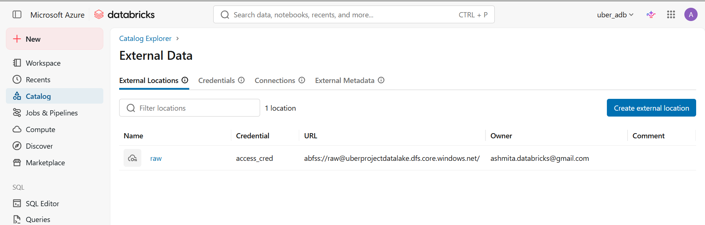

## 6. Databricks — Bronze Layer (`bronze_adls.py`)

- Reads raw JSON from ADLS (`BASE_PATH = "abfss://raw@uberprojectdatalake.dfs.core.windows.net/ingestion"`) for every mapping/reference file (`map_cities`, `map_cancellation_reasons`, `map_payment_methods`, `map_ride_statuses`, `map_vehicle_makes`, `map_vehicle_types`) plus the one-time historical `bulk_rides` load.
- A shared `read_json` helper handles both JSON array and JSON-Lines formats defensively, so a source file's exact shape doesn't break ingestion.
- Writes land as overwrite-mode tables in `uber_cat.bronze`.


## 7. Databricks — Silver Layer

**`silver_stream_ride_tst.py`** (exploration/test notebook) defines the `rides_schema` `StructType` — every ride field typed explicitly (fares, timestamps, lat/long, driver/passenger/vehicle attributes) — and documents that this notebook is for testing only, with the real logic running from the pipeline's `silver_stg` flow.

**`silver_stream_stg.py`** (the pipeline notebook) uses `dp.create_streaming_table("uber_cat.silver.stream_rides_stg")` with two `@dp.append_flow` functions feeding the same target: `rides_bulk()` reads `bulk_rides` once and casts `booking_timestamp`, while `rides_stream()` reads the live `rides_raw` stream and parses the JSON `rides` payload against `rides_schema` — both converging into one streaming staging table.

**`silver_jinja_obt.py`** generates the Silver One-Big-Table SQL dynamically with Jinja2 — the same metadata-driven templating pattern used on the Spotify project: a template loops over a `jinja_config` list, rendering a `SELECT` column list and a `FROM`/`LEFT JOIN` chain, so a new lookup join is a metadata entry, not new SQL.

**`silver_obt.sql`** is the resulting Silver OBT:
```sql
CREATE OR REFRESH STREAMING TABLE uber_cat.silver.silver_obt
```
It streams from `stream_rides_stg` with a 3-minute watermark (tolerating late-arriving ride events) and left-joins every Bronze lookup table — vehicle makes/types, ride statuses, payment methods, cities, cancellation reasons — so every downstream Gold table reads from one clean, fully-enriched streaming source instead of re-joining raw dimensions itself.


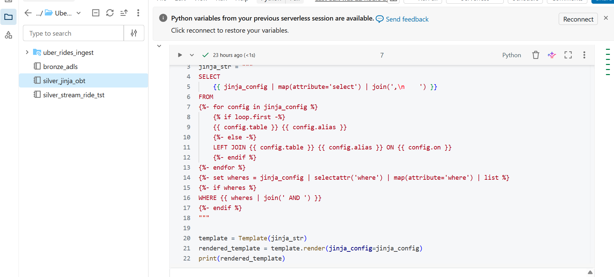
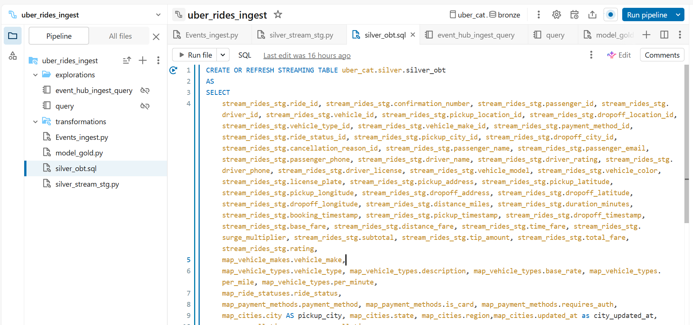
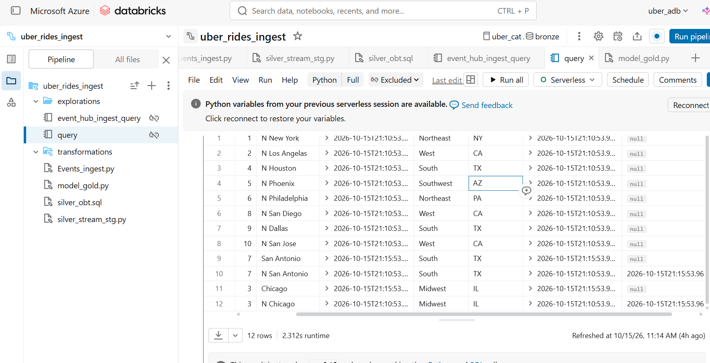

## 8. Databricks — Gold Layer (`model_gold.py`)

Built with the `pyspark.pipelines` (`dp`) API and `dp.create_auto_cdc_flow`, all sourced from streaming views over `silver_obt`:

| Table | Grain / key | SCD type |
|---|---|---|
| `dim_passenger` | `passenger_id` | 1 |
| `dim_driver` | `driver_id` | 1 |
| `dim_vehicle` | `vehicle_id` | 1 |
| `dim_payment` | `payment_method_id` | 1 |
| `dim_booking` | `ride_id` | 1 |
| **`dim_location`** | `pickup_city_id`, sequenced by `city_updated_at` | **2** |
| `fact` | `ride_id`, `pickup_city_id`, `payment_method_id`, `driver_id`, `passenger_id`, `vehicle_id` | 1 |

`dim_location` is the one table that keeps full history: every change to a city's `region`/`state` data inserts a new version with its own `__START_AT`/`__END_AT` validity window, rather than overwriting the row — the same SCD Type 2 pattern proven out on the Spotify project, here implemented with the newer `pyspark.pipelines` API instead of `dlt`. The fact table carries every trip metric (distance, duration, fare components, surge multiplier, tip, rating) at the individual-ride grain.

The full pipeline (`uber_rides_ingest`) runs this entire DAG — Event Hub subscription and Bronze landing through Silver OBT and every Gold CDC flow — as one Lakeflow Declarative Pipeline. The lineage graph shows the complete fan-out: `rides_raw`/`bulk_rides` → `stream_rides_stg` → `silver_obt` → six lookup joins → seven Gold views → seven Gold CDC tables, all completed successfully across 17 tables.


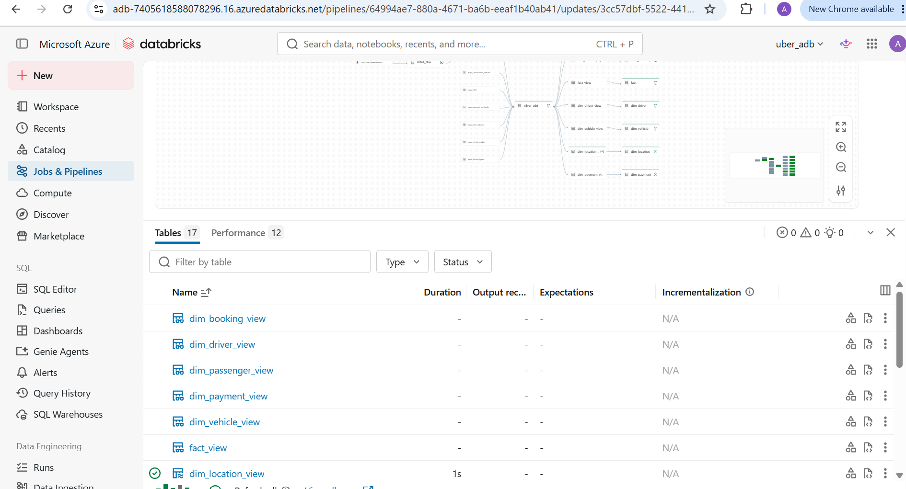
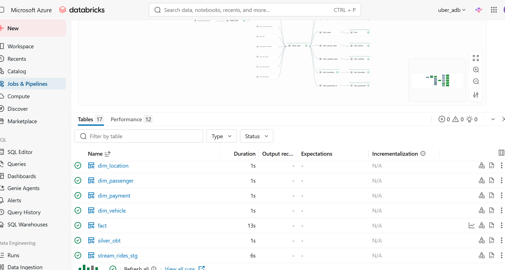


## 9. Unity Catalog — Governed Catalog Structure & Pipeline Runs

**Catalog:** `uber_cat`:
- **`bronze`** (9 tables + 1 volume) — `rides_raw`, `bulk_rides`, `dim_location_view`, and the `map_*` reference tables, plus `my_volume`
- **`silver`** (2 tables) — `stream_rides_stg`, `silver_obt`
- **`gold`** (7 tables) — `dim_booking`, `dim_driver`, `dim_location`, `dim_passenger`, `dim_payment`, `dim_vehicle`, `fact`
- plus `default` and `information_schema`

The `uber_rides_ingest` Lakeflow pipeline's own run history (Jobs & Pipelines → Runs) shows consistent manual-trigger runs succeeding end to end, durations ranging from under a minute to a few minutes depending on backlog.

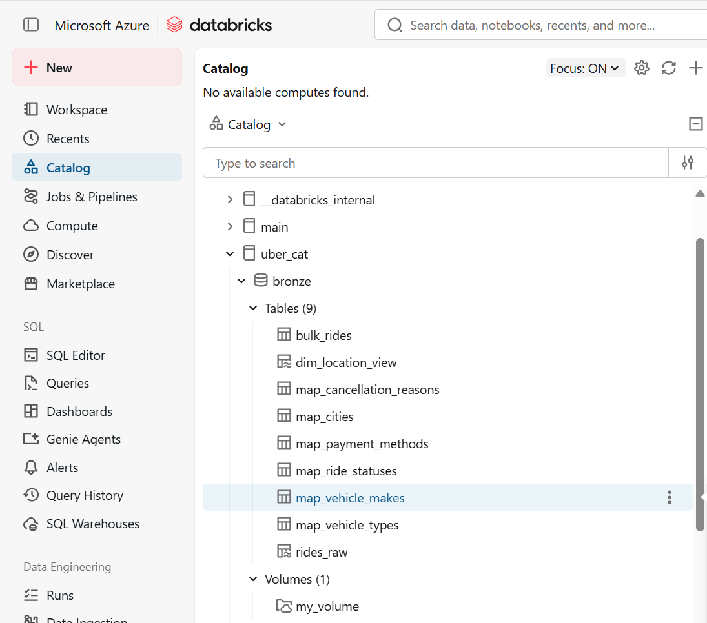

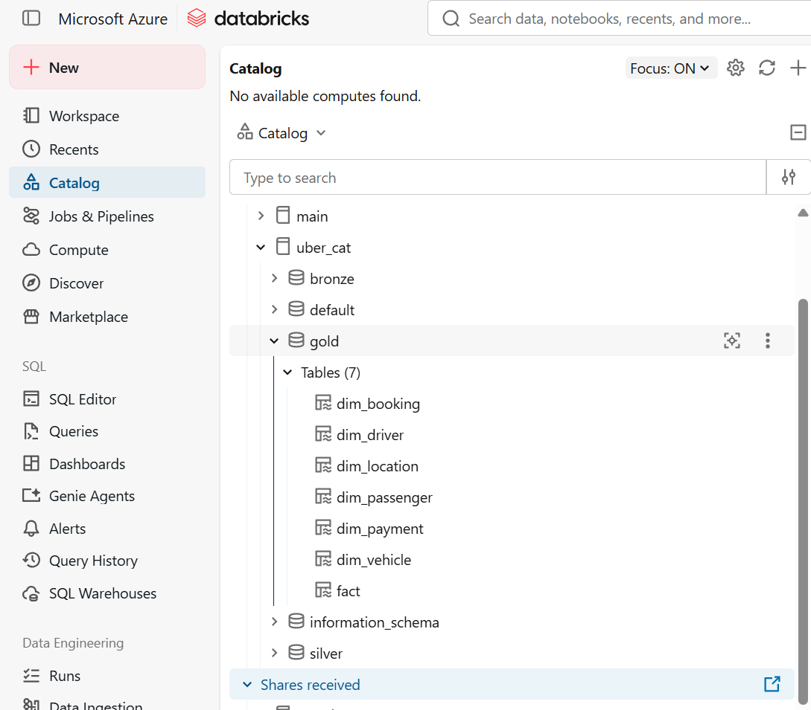


## Tech Stack

- **Streaming ingestion:** Azure Event Hub (Kafka-compatible protocol, Send/Listen SAS policies), Python producer (local, `uv`-managed venv)
- **Orchestration:** Azure Data Factory (metadata-driven `ForEach` ingestion, Git-integrated, PR-based workflow)
- **Storage:** Azure Data Lake Storage Gen2 (Bronze / Silver / Gold medallion architecture)
- **Compute:** Azure Databricks (`uber_adb`), Spark Structured Streaming, Spark Declarative Pipelines (`pyspark.pipelines`)
- **Governance:** Unity Catalog (`uber_unity_metastore`) with an Access Connector managed identity — no embedded storage keys
- **Templating:** Jinja2 for metadata-driven Silver SQL generation
- **Source control:** GitHub (`AshmitaSarkar92/Uber-Azure-DE-Project`), with ADF Git integration, PR-based merges, and secret-scanning-verified pushes

## Repository Structure

```
├── Raw_Data/                 # Raw mapping/bulk JSON source files for ADF HTTP ingestion
├── adf_pipelines/            # Azure Data Factory pipeline, dataset, and linked service JSON (Git-integrated)
├── src/uber_de_project/      # Python Event Hub producer app (connection.py, data.py, api.py)
├── databricks/
│   └── Uber_Project/
│       ├── bronze_adls.py            # Bronze landing (raw JSON, array + JSON-Lines aware)
│       └── uber_rides_ingest/
│           ├── explorations/
│           │   ├── event_hub_ingest_query.py  # Kafka consumer exploration notebook
│           │   └── query.py                   # Ad hoc Silver/Gold query notebook
│           └── transformations/
│               ├── Events_ingest.py      # Event Hub (Kafka-compatible) consumer config
│               ├── silver_stream_stg.py  # Streaming staging (stream_rides_stg) — bulk + live flows
│               ├── silver_obt.sql        # Silver One-Big-Table (watermarked, lookup-joined)
│               └── model_gold.py         # Gold layer — SCD1 dims, SCD2 dim_location, fact
└── screenshots/
    ├── uber_resource_group_ss/
    ├── uber_eventhub_ss/
    ├── uber_adf_ss/
    ├── uber_datalake_ss/
    ├── uber_access_connector_ss/
    ├── uber_unitycatalog_ss/
    └── uber_databricks_ss/
```
